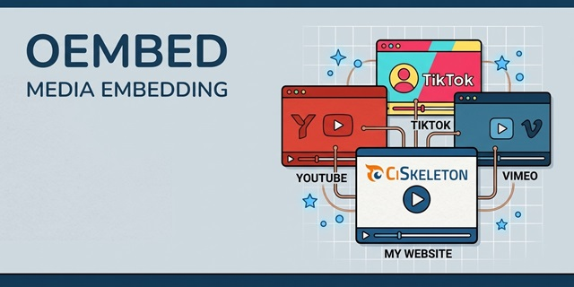

# CiSkeleton Plugin — oEmbed

**Plugin for CiSkeleton** that provides a unified, consistent interface for embedding media from popular providers via [oEmbed](https://oembed.com/) endpoints.

<p align="center">
  
</p>

Supports automatic provider detection, runtime caching, persistent caching, response normalization, and dynamic provider registration.

## Table of Contents

- [Features](#features)
- [Supported Providers](#supported-providers)
- [Installation](#installation)
- [Usage](#usage)
- [Registering Custom Providers](#registering-custom-providers)
- [Caching](#caching)
- [License](#license)

## Features

- **Auto Provider Detection:** Embed URLs automatically detect YouTube, Vimeo, TikTok, Reddit, Dailymotion, Flickr, Twitter, etc.
- **Normalized Responses:** Consistent structure across providers for titles, authors, thumbnails, HTML, and more.
- **Runtime & Persistent Caching:** Avoid repeated API calls within a request and optionally store results in CiSkeleton cache.
- **Dynamic Provider Registration:** Add custom providers at runtime.
- **Lightweight:** Pure PHP, no external dependencies beyond CiSkeleton’s cURL helper.

## Supported Providers

- YouTube
- Vimeo
- Dailymotion
- Flickr
- Twitter/X
- TikTok
- Reddit

> Note: Providers like SoundCloud and Instagram are omitted due to requiring Client ID or Access Tokens. You can add them via custom registration if needed.

## Installation

1. Install the plugin via `Plugins Browser` or place it in your `application/plugins/` directory if you have the package.
2. Ensure the folder structure includes: `src/services/CI_Oembed_service.php`, `src/metadata.php`, and `src/boot.php`.
3. Enable the plugin on the dashboard.
4. Load the service anywhere in your code using `$this->load->service('oembed')`, or directly via `service('oembed')` helper. The latter returns the service's object.

## Usage

**Fetch oEmbed Data**

```php
// By loading the service:
$this->load->service('oembed');
$data = $this->oembed_service->fetch('https://www.youtube.com/watch?v=dQw4w9WgXcQ');

// Or using service() helper:
$data = service('oembed')->fetch('https://www.youtube.com/watch?v=dQw4w9WgXcQ');

// Then:
if ($data) {
  echo $data['title'];        // Video title
  echo $data['author_name'];  // Author
  echo $data['html'];         // Embeddable HTML
}
```

**Embed Directly in HTML**
```php
echo service('oembed')->to_html('https://www.tiktok.com/@user/video/123456789');
```

## Registering Custom Providers

You can register a new provider at runtime. **Important**: the URL must include a `%s` placeholder for the media URL.

```php
// By loading the service:
$this->load->service('oembed');
$this->oembed_service->register(
  'myprovider',
  'https://api.myprovider.com/oembed?url=%s&access_token=XYZ',
  ['myprovider.com', 'mp.com']
);

// Or using service() helper:
service('oembed')->register(
  'myprovider',
  'https://api.myprovider.com/oembed?url=%s&access_token=XYZ',
  ['myprovider.com', 'mp.com']
);
```

Then you can fetch embeds as usual:

```php
// By loading the service:
$this->load->service('oembed');
$data = $this->oembed_service->fetch('https://myprovider.com/media/abc123');

// Or using service() helper:
$data = service('oembed')->fetch('https://myprovider.com/media/abc123');
```

## Caching

* **Runtime (In-memory)**: Each request caches repeated fetches automatically.
* **Persistent**: Uses CiSkeleton’s cache driver if available.
* Cache key format: `oembed_{md5(provider + url)}`.
* Default TTL: **24 hours**.

```php
$data = service('oembed')->fetch($url, null, true); // true = cache enabled
```

## Error Handling

* Invalid URLs or unsupported providers return `false`.
* Attempting to register a provider without a `%s` placeholder will throw an `InvalidArgumentException`.

## License

MIT License. See [LICENSE](LICENSE.md) for details.

---

<div align="center">
  <sub><a href="https://github.com/ciskeleton">CiSkeleton</a> is created, developed, and maintained by <a href="https://github.com/bkader">Kader Bouyakoub</a>, trading as <a href="https://github.com/ianhubnet">Ianhub</a>.</sub>
</div>
